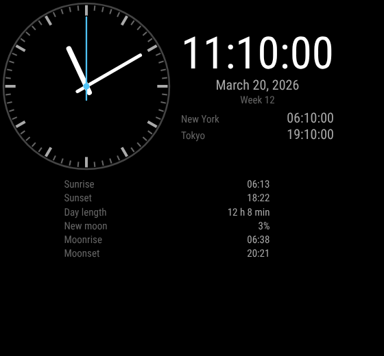

# mm3-clock

Digital and analog clock for MM3, with extra time zones, the ISO week number,
and optional sun and moon times. It is front-end only: the time comes from the
browser and is shown in the mirror's time zone.

```yaml
- module: clock
  id: clock
  position: top_left
  config:
    display: both
    show_seconds: true
    zones:
      - timezone: America/New_York
      - timezone: Asia/Tokyo
        label: {en: Tokyo, it: Tokyo}
    sun: true
    moon: true
```



## Configuration

| Option | Values | Default |
| --- | --- | --- |
| `display` | `digital`, `analog`, `both` | `digital` |
| `show_seconds` | bool | `true` |
| `time_format` | `locale`, `12`, `24` | `locale` |
| `show_date` | bool | `true` |
| `date_style` | `short`, `medium`, `long`, `full` | `long` |
| `show_week` | bool (ISO 8601 week number) | `false` |
| `timezone` | IANA name replacing `engine.timezone` for this clock | none |
| `zones` | up to 4 of `{timezone, label}` | none |
| `face` | `numbers`, `ticks`, `none` | `ticks` |
| `sun` | bool: sunrise, sunset, day length | `false` |
| `moon` | bool: phase, illumination, moonrise, moonset | `false` |
| `location` | `{lat, lon}`; default `engine.location` | none |

Sun and moon values are computed in the browser (NOAA solar equations and a
Meeus low-precision lunar series), with no library. They agree with an
independent ephemeris within 2 minutes (sun), 10 minutes (moon) and one
percentage point (illumination) between latitudes -60 and 60. The test fixture
`tests/fixtures/almanac.json` is generated by `tests/fixtures/make_almanac.py`.

## Notifications

Emits none, consumes none.

## Grants

None.
