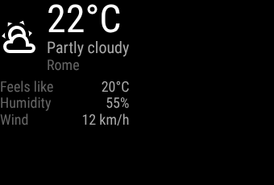
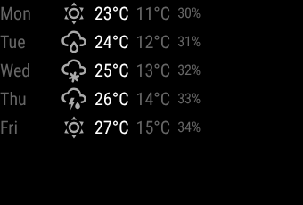

# mm3-weather

Current weather, daily and hourly forecasts for MM3. The backend fetches from a
provider (Open-Meteo is built in, no API key), keeps the last good data and
shares the current conditions with other modules.

```yaml
- module: weather
  id: weather
  position: top_right
  config:
    type: current        # current | daily | hourly
    location: {lat: 41.9028, lon: 12.4964, name: Roma}   # default: engine.location
    show_humidity: true
  grants:
    http: ["https://api.open-meteo.com/"]
```

 

## Configuration

| Option | Values | Default |
| --- | --- | --- |
| `type` | `current`, `daily`, `hourly` | `current` |
| `provider` | name of a provider | `open_meteo` |
| `provider_options` | options of the provider | none |
| `location` | `{lat, lon, name?}`; without one the instance is disabled (`CFG_LOCATION_REQUIRED`) | `engine.location` |
| `units` | `metric`, `imperial` | `engine.units` |
| `refresh` | duration, at least 5 minutes | 10 minutes |
| `days` | 1-16, entries of the daily view | 5 |
| `hours` | 1-48, entries of the hourly view | 8 |
| `hour_step` | 1-6, hours between hourly entries | 1 |
| `emit` | send `WEATHER_CURRENT` after each refresh | `true` |
| `show_feels_like`, `show_humidity`, `show_wind`, `show_precipitation`, `show_sun` | display options (`show_sun` adds sunrise and sunset to the daily view) | `true`, then `false` |

Temperatures are in °C or °F, wind in km/h or mph and precipitation in mm or
inches, converted once by the provider request. Times are aware ISO 8601
strings in the mirror's time zone.

## Views

`current` shows the icon, temperature, condition text and the optional fields,
`daily` one row per day (weekday, icon, maximum and minimum, rain probability)
and `hourly` a strip of hours. The element sizes its text to the cell and shows
fewer rows or hours, or leaves out optional fields, when the cell is small.
Data without a success for more than twice `refresh` is dimmed and shows its age.

Icons are Material Design Icons (Apache-2.0) vendored in `static/icons/` with
their licence; `static/icons.js` holds the same path data and a test keeps the
two in step.

## Grants

`http: ["https://api.open-meteo.com/"]` for the built-in provider. Without it the
instance keeps running and shows a message naming the grant to add.

## Notifications

Emits `WEATHER_CURRENT` (registered, core spec 5.5) after every successful
refresh when `emit` is on: `location`, `condition`, `is_day`, `temperature`,
optional `feels_like`, `humidity` and `wind_speed`, `units` and `observed_at`
(UTC). Consumes none.

## Conditions

The condition set is closed: `clear`, `partly_cloudy`, `cloudy`, `fog`,
`drizzle`, `rain`, `heavy_rain`, `freezing_rain`, `snow`, `sleet`,
`thunderstorm`, `hail`. The WMO code table of the Open-Meteo provider is in
`mm3_weather/open_meteo.py`; an unmapped code becomes `cloudy`.

## Providers

A provider is a class registered in the entry point group
`mm3_weather.providers` with `name`, `options_model` (a Pydantic model for
`provider_options` or `None`), `url_prefix` and
`async fetch(http, request) -> WeatherData`.
